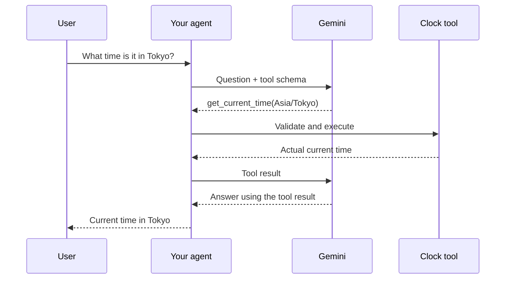
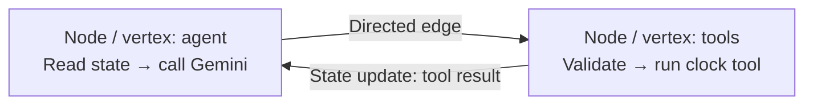
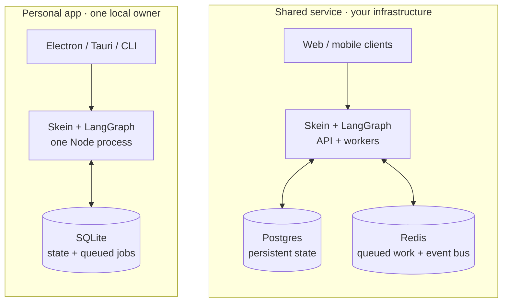

<div class="kicker">Builders Space · 28 October 2026</div>

# Beyond the SDK

<div class="lead">Build agentic applications<br>with LangGraph & SkeinJS</div>


<div class="bottom small">
<strong>Maina Wycliffe, Founder Garatropic</strong><br>
<a class="social-link" href="https://www.linkedin.com/in/mainawycliffe/" aria-label="LinkedIn: mainawycliffe"> mainawycliffe</a> · <a class="social-link" href="https://x.com/_mainawycliffe" aria-label="Twitter: @_mainawycliffe"> @_mainawycliffe</a>
</div>

<!--
00:00–01:00. Introduce yourself using the event bio: founder of Garatropic, creator of SkeinJS, Google Developer Expert for Angular. Today's question: you already integrated Gemini; how does someone actually use the application?
Source: https://luma.com/hp7jn59h (public event description, retrieved 28 October 2026). Company and LinkedIn supplied by presenter.
Logo: official docs/public/skein-knot-dark.svg from https://github.com/skein-js/skein-js, unchanged.
-->

---

# The user wants a working assistant

<div class="statement">“What time is it in Tokyo?<br>And in Nairobi?”</div>

<div class="bottom lead muted">One tool. A follow-up. A conversation they can return to.</div>

<!--
01:00–04:00. This is the actual scenario supported by this repository. Ask who has already made a successful model call. Keep this one small application as the thread of the talk. Do not promise approvals or cross-thread semantic memory in this Angular app: those are later, separate demonstrations.
Source: repository README.md and apps/agent/src/time.ts.
-->

---
class: demo
---

<div class="kicker">Live demo</div>

# Call Gemini directly

```ts
import { ChatGoogleGenerativeAI } from '@langchain/google-genai';

const model = new ChatGoogleGenerativeAI({
  model: process.env.MODEL_NAME!,
  apiKey: process.env.GOOGLE_API_KEY!,
});

const reply = await model.invoke('What time is it in Tokyo right now?');
console.log(reply.content);
```


<!--
04:00–08:00. Run `npm run demo:sdk` from the presentation directory after configuring apps/agent/.env for Google and a working Gemini MODEL_NAME. GOOGLE_API_KEY is explicitly supplied to the SDK. Do not expose the env file on the projector. Inspect demo/sdk-call.mjs. The response is nondeterministic: do not claim it always gets the time wrong. Ask what evidence the application has that live time was checked. If unavailable, read the script and move on, explicitly saying no provider result was obtained.
-->

---

# Then a user asks…

<div class="requests">
<div><q>And in Nairobi?</q><span>Conversation state</span></div>
<div><q>Can I come back to this?</q><span>Threads + persistence</span></div>
<div><q>What is it doing?</q><span>Streaming + tool activity</span></div>
<div><q>Ask me before booking.</q><span>Interrupt + resume</span></div>
</div>

<!--
08:00–10:00. Distinguish model capabilities from product behavior. An SDK can expose tools, streaming, provider-side state and retries. It does not select your authorization policy, storage lifetime, UI recovery semantics, or side-effect contract. Later requirements motivate both orchestration and serving infrastructure. This progression is grounded in https://skein-js.github.io/skein-js/why; examples here are also implemented in the local app except the explicitly introduced later extensions.
-->

---

# Tool calling needs a control loop



<div class="visual-takeaway">The model proposes the call. Your application executes it.</div>

<!--
10:00–11:00. Open apps/agent/src/time.ts and point at the timezone schema and Intl.DateTimeFormat usage. The model does not itself run your JavaScript function. For mutating tools, validation and permissions belong at the execution boundary; this demo tool only reads the clock.
Sources: apps/agent/src/time.ts; https://docs.langchain.com/oss/javascript/langgraph/overview.
-->

---

# Nodes are the steps; edges connect them



<div class="node-definitions"><div><strong>Node = vertex</strong><br>A named function that reads state<br>and returns an update</div><div><strong>Edge = connection</strong><br>An arrow tells the graph<br>where execution may go next</div></div>

<!--
11:00–12:00, within the existing graph explanation budget. Define vertex as the graph-theory synonym of node. A vertex is not an arrow; the arrow is a directed edge. agent and tools are actual node names in apps/agent/src/agent-graph.ts. StateGraph nodes generally return partial state updates; reducers decide how to apply updates. START and END are special routing markers, not model calls. Source: https://docs.langchain.com/oss/javascript/langgraph/graph-api and local graph source.
-->

---

# Directed does not mean “only once”

<GraphComparison />

<div class="visual-takeaway">Directed = follow arrow direction · Cyclic = a path can return to a node</div>

<!--
12:00–13:00, within graph explanation budget. A directed graph can be cyclic or acyclic. The left example is an illustrative one-way draft/review/send pipeline, not functionality implemented in this chat app. The right is the local agent/tools loop: repeated tool calls are possible, and toolsCondition exits when no tool call remains. A recursion limit bounds steps; it is not a guarantee that the answer is correct. LangGraph does not require every graph to contain cycles. Source: local agent-graph.ts; https://docs.langchain.com/oss/javascript/langgraph/graph-api.
-->

---
class: compact
---

# An example graph

<div class="graph-with-code">
<div>

```ts
const agent = async (state) => ({
  messages: [await model.invoke([
    instructions, ...state.messages,
  ])],
});

export const graph = new StateGraph(MessagesAnnotation)
  .addNode('agent', agent)
  .addNode('tools', new ToolNode(tools))
  .addEdge('__start__', 'agent')
  .addConditionalEdges('agent', toolsCondition)
  .addEdge('tools', 'agent')
  .compile();
```

</div>
<AgentGraph />
</div>

<!--
13:00–14:00. Same local graph construction, with the agent node function extracted into a named variable for readability. The diagram uses the same node names and routing. Show model.ts next: the Google branch constructs ChatGoogleGenerativeAI; binding tools leaves graph routing unchanged. LangChain's provider adapter wraps the model call here, the same LangChain provider adapter used in Demo 01.
Source: apps/agent/src/agent-graph.ts and apps/agent/src/model.ts.
-->

---

# What LangGraph gives you

<div class="capability-comparison">
<div>
<h2>Inside your workflow</h2>
<div class="capability"><b>State and control flow</b><span>Nodes · edges · branches · loops</span></div>
<div class="capability"><b>Streaming</b><span>Model output and graph updates</span></div>
<div class="capability"><b>Pause and resume</b><span>Wait for a person, then continue</span></div>
<div class="capability"><b>Save and restore state</b><span>Checkpoints and cross-thread stores</span></div>
</div>
<div>
<h2>You still need to provide</h2>
<div class="capability"><b>An API people can call</b><span>HTTP endpoints and client connections</span></div>
<div class="capability"><b>A configured backend</b><span>Database · storage lifetime · deployment</span></div>
<div class="capability"><b>Jobs and operations</b><span>Job queues · schedules · a console</span></div>
<div class="capability"><b>Your product rules</b><span>Sign-in · permissions · tools · UI</span></div>
</div>
</div>

<div class="capability-scope">LangGraph.js library, not LangSmith Deployment · persistence needs configured checkpointers / stores</div>

<!--
14:00–15:00. Make the boundary explicit before the tool demonstration and the introduction of Skein. LangGraph provides orchestration, streaming, interrupt/resume, and persistence interfaces; these are not Skein inventions. Checkpoint-backed resume and persistence require configuring a checkpointer; cross-thread data uses a configured store, and the application chooses recall behavior. A compiled graph alone does not install a deployed Agent Protocol server, database service, scheduler, console, identity policy, or product UI. You can build that layer yourself, use LangSmith Deployment / Agent Server, or choose a runtime such as Skein. This comparison is the open-source LangGraph.js library versus the surrounding application infrastructure, not a claim that LangChain's broader platform lacks these capabilities. Use a minute of the existing graph/demo budget.
Sources: https://docs.langchain.com/oss/javascript/langgraph/overview ; https://docs.langchain.com/oss/javascript/langgraph/persistence ; https://skein-js.github.io/skein-js/why .
-->

---
class: demo
---

<div class="kicker">Live demo</div>

# Follow one tool call

<div class="prompt">“What time is it in Tokyo right now?”</div>

<ToolCallTrace />

<!--
14:00–17:00. Open localhost:4200 after pnpm dev at repository root. Source files: time.ts, agent-graph.ts, model.ts. If a model skips the tool, use the explicit prompt on the slide, then inspect actual output instead of claiming a call happened. No live code edits are required. The live run is distinct from unit tests using fake model responses.
-->

---

# Four layers in the working app

<ArchitectureDiagram />

<!--
18:00–20:00. Network path is Angular → Skein → LangGraph → model/tools, with SSE returning events. @langchain/angular is the frontend binding, not a Skein-authored component. LangGraph's checkpointer is supplied by the Skein runtime. The app uses a same-origin /agent proxy in development.
Sources: README.md, apps/web/proxy.conf.json, apps/web/src/app/chat.ts, https://skein-js.github.io/skein-js/.
-->

---

# Why SkeinJS exists

<div class="why-sequence">
<div><span>01</span><b>Your agent works</b><small>Model calls + tools + graph</small></div>
<div><span>02</span><b>People want to use it</b><small>History + streaming + approvals + jobs</small></div>
<div><span>03</span><b>You are building a runtime</b><small>The same backend work, again</small></div>
</div>
<div class="visual-takeaway">Skein packages that work: TypeScript · Apache-2.0 · your infrastructure</div>


<!--
20:00–21:00. This is the project's documented motivation, not an invented founder anecdote. The Why page describes the recurring accumulation of persistence, streaming, approvals, scheduling, callbacks and operational inspection. It names aegra as inspiration, with a TypeScript runtime as the project's fit for JS teams. Do not claim zero operating cost: you still pay for infrastructure and models. Do not quote unverified current competitor pricing.
Source: https://skein-js.github.io/skein-js/why and https://github.com/skein-js/skein-js/blob/main/LICENSE.
-->

---
class: example-story
---

<div class="kicker">From one answer to a conversation</div>

# “And in Nairobi?” needs the same thread

<div class="app-story">
<div class="app-evidence"><div class="app-evidence-caption">Angular app · deterministic fixture + real clock tool</div></div>
<div class="story-aside">
<div><b>Same thread</b><p>Keep the previous turns.</p></div>
<div><b>New chat</b><p>Start a separate conversation.</p></div>
<div><b>Come back later</b><p>Load the thread from the server.</p></div>
</div>
</div>

<div class="example-links"><a href="https://github.com/skein-js/skein-js/tree/main/examples/chat-app">Chat app example ↗</a><a href="https://github.com/skein-js/skein-js/tree/main/examples/react-usestream">React example ↗</a></div>

<!--
21:00–29:00. Walk through the captured application rather than requiring a live demo. This screenshot is from this repository's actual Angular UI, cropped to its message list, against demo/chat-fixture.ts. It uses a deterministic fake model and real clock tool; it is not Gemini-generated text. Thread state lives on the running server; the memory-only fixture loses state on backend restart. The linked chat-app and react-usestream are upstream examples, not this exact Angular UI. Optional local app: http://localhost:4200.
Sources: apps/web/src/app/chat.ts; demo/chat-fixture.ts; https://github.com/skein-js/skein-js/tree/main/examples/chat-app; https://github.com/skein-js/skein-js/tree/main/examples/react-usestream.
-->

---

# Angular and React · same agent API

<div class="framework-code">
<div>

### Angular example

<div class="small muted">@langchain/angular · Signals</div>

```ts
readonly threadId = signal<string | null>(null);
readonly stream = injectStream<ChatState>({
  apiUrl,
  assistantId: 'chat',
  threadId: this.threadId,
  onThreadId: (id) => this.threadId.set(id),
});

this.stream.messages();
await this.stream.submit({ messages });
```

</div>
<div>

### React example

<div class="small muted">@langchain/react · Hook</div>

```tsx
const [threadId, setThreadId] =
  useState<string | null>(null);
const stream = useStream<ChatState>({
  apiUrl,
  assistantId: 'chat',
  threadId,
  onThreadId: setThreadId,
});

stream.messages;
await stream.submit({ messages });
```

</div>
</div>

<div class="visual-takeaway">Same Skein API + chat graph · Angular reads signals; React reads hook state</div>

<!--
29:00–30:00. The Angular excerpt is simplified from the local Chat service: threadId is named activeIdState there; imports, apiUrl setup and UI event handlers are omitted. The React equivalent uses @langchain/react useStream; it is illustrative code, not an app added to this repository. In React submit belongs in an event handler, not during render. React source: https://github.com/skein-js/skein-js/tree/main/examples/react-usestream and the current @langchain/react useStream types. The binding provides Angular signals; the application renders them. Show final send/stop/retry implementation in source, because SDK 1.x transport differs from the original pinned 0.4.8. Avoid promising compatibility with all versions: use the pinned and tested versions recorded in README and SOURCES.md.
Sources: apps/web/src/app/chat.ts; https://github.com/langchain-ai/langgraphjs/tree/main/libs/sdk.
-->

---

# Thread, run, checkpoint, memory

<div class="thread-map">
<div class="lane-title">Thread A · planning a Tokyo trip</div>
<div class="thread-flow"><div><b>Run 1</b><span>“Tokyo time?”</span></div><i>→</i><div class="saved-state"><b>Checkpoint</b><span>Saved graph state</span></div><i>→</i><div><b>Run 2</b><span>“And Nairobi?”</span></div></div>
<div class="separate-thread"><b>Thread B · a new conversation</b><span>Its own history</span></div>
<div class="memory-line"><b>Store memory</b><span>Selected facts an app can recall across threads</span></div>
</div>

<div class="visual-takeaway">This app uses thread history. Cross-thread recall needs separate application code.</div>

<!--
30:00–32:00. A follow-up working is evidence of thread history, not semantic memory. A resumed approval is a new run on the same thread. Store APIs provide storage; the app chooses what to save, whose namespace it belongs to, and how to recall it. In-memory checkpoints only last for the process in our configured demo.
Sources: https://skein-js.github.io/skein-js/threads, https://skein-js.github.io/skein-js/human-in-the-loop, README.md.
-->

---
class: console-bridge
---

<div class="kicker">Console · 1 of 3 · start with the user’s report</div>

# The answer looks wrong. What happened?

<div class="console-scenario">“I asked about Nairobi. Why did it answer Tokyo?”</div>

<ConsoleIntro />

<div class="visual-takeaway">Let’s follow the evidence in the Skein console.</div>

<!--
32:00–33:00, within the existing console demo budget. This is a hypothetical user report, not an observed failure in the app. We have just explained threads, runs and checkpoints; now show why we need to inspect them. Ask whether this could be the wrong conversation, the wrong timezone argument, an unexpected tool result, or stale state. The final answer alone cannot tell us which. Transition: “Skein gives us a console to inspect the conversation and the run behind it.” On the next slide, open the actual app thread and follow its observed activity; do not pretend the official screenshot records this hypothetical bug.
Sources: local apps/agent/src/time.ts and apps/web/src/app/chat.ts; https://skein-js.github.io/skein-js/console .
-->

---
class: example-story
---

<div class="kicker">Console · 2 of 3 · follow the run</div>

# What actually happened behind the answer?

<div class="console-story">

<div class="story-aside">
<div><b>1 · Did it finish?</b><p>Read the run status.</p></div>
<div><b>2 · Which tool?</b><p>Open the request and check its arguments.</p></div>
<div><b>3 · What came back?</b><p>Compare the tool result with the answer.</p></div>
</div>
</div>
<div class="example-links"><span>Official console screenshot · research example</span><a href="https://skein-js.github.io/skein-js/console">Console guide ↗</a></div>

<!--
33:00–35:00. Continue the hypothetical Nairobi/Tokyo investigation. This official screenshot shows a research run, not that incident. Point to status, expandable tool request, result, final answer. Explain how the same checks would reveal a wrong timezone argument or unexpected result in our clock graph. Activity depends on retained events. Do not claim the screenshot proves the cause of the hypothetical bug.
Source: https://github.com/skein-js/skein-js/blob/main/docs/public/images/console/run-dark.png; https://skein-js.github.io/skein-js/console.
-->

---
class: example-story
---

<div class="kicker">Console · 3 of 3 · inspect the saved state</div>

# Was the right conversation carried forward?

<div class="console-story">

<div class="story-aside">
<div><b>Conversation</b><p>Was the follow-up in the right thread?</p></div>
<div><b>State</b><p>What values did the graph keep?</p></div>
<div><b>Checkpoints</b><p>What was saved along the way?</p></div>
</div>
</div>
<div class="example-links"><span>Official console screenshot · research example</span><a href="https://github.com/skein-js/skein-js/tree/main/examples/triage-agent">Triage + console example ↗</a></div>

<!--
35:00–38:00. Connect back to the earlier thread/run/checkpoint definitions. Screenshot is on Conversation; State and Checkpoints are visible tabs, not pictured open. Use them as navigation cues, not as fabricated state evidence. For the hypothetical report, inspect thread identity and history, then saved state and checkpoints before deciding where the fault lies. Transition to approval: saved state also lets us pause and wait for a person. The console is an API client, not the owner of application state.
Sources: https://github.com/skein-js/skein-js/blob/main/docs/public/images/console/thread-detail-dark.png; https://skein-js.github.io/skein-js/console; https://github.com/skein-js/skein-js/tree/main/examples/triage-agent.
-->

---

# A human decision is saved state

<div class="approval-with-code">
<div>

```ts
const approved = interrupt({
  question:
    'Approve this simulated booking?',
  request: state.request,
  simulated: true,
});

return { approved: approved === true };
```

<div class="code-note">Simulated booking · no real transaction</div>

</div>
<ApprovalFlow />
</div>

<div class="visual-takeaway">Resume with a decision → a new run continues on the same thread</div>

<!--
38:00–39:00. This is a new, clearly labeled deterministic fixture, separate from the existing Angular app. LangGraph provides interrupt(); Skein supplies checkpointer integration, protocol endpoints and console. A checkpointer is required. The node restarts on resume; do not put non-idempotent side effects before the interrupt. A boolean true is the approval value for this fixture; strings or objects do not silently count as approval. In-memory pauses disappear on restart.
Sources: local demo/approval-graph.ts; https://skein-js.github.io/skein-js/human-in-the-loop; https://docs.langchain.com/oss/javascript/langgraph/interrupts.
-->

---
class: example-story
---

<div class="kicker">Recorded example · approval across channels</div>

# A refund waits for three people

<div class="recording-story">
<video controls preload="metadata" poster="/images/refund-recording-poster.png" src="/images/decoupled-refund-approval.mp4" aria-label="Official SkeinJS recording of the refund approval example"></video>
<div class="story-aside">
<div><b>Email arrives</b><p>A refund request starts the graph.</p></div>
<div><b>HR · Manager · Finance</b><p>Each person replies to their own approval request.</p></div>
<div><b>Result by email</b><p>The graph continues when decisions are collected.</p></div>
</div>
</div>
<div class="example-links"><span>Official recording · simulated email + WhatsApp providers</span><a href="https://github.com/skein-js/skein-js/tree/main/examples/decoupled-delivery">Refund approval example ↗</a></div>

<!--
39:00–44:00. Play the bundled official recording. This is the upstream decoupled-delivery example, replacing the local simulated-flight demo instructions. The graph pauses on three parallel interrupts; replies target exact interrupt IDs and can arrive in any order. Each node checks the server-owned principal against the assigned approver. Graph and channel orchestration are real; provider clients are recording fakes. No actual email, WhatsApp message or refund is sent. This is a newer upstream example, not a claim the presentation's pinned 0.23.0 fixture implements every API in it.
Sources: https://github.com/skein-js/skein-js/tree/main/examples/decoupled-delivery; https://github.com/skein-js/skein-js/blob/main/docs/videos/decoupled-refund-approval.mp4.
-->

---
class: example-story
---

<div class="kicker">Background work · the browser can leave</div>

# “Sort these issues. Tell me when it’s done.”

<div class="background-path">
<div><b>Submit</b><span>Get a run ID back</span></div><i>→</i><div><b>Work on the server</b><span>Read → classify → save</span></div><i>→</i><div><b>Deliver the result</b><span>Callback to another service</span></div>
</div>

```ts
const run = await client.runs.create(null, 'agent', {
  input: { documentUrl },
  onCompletion: 'delete',
  webhook: 'https://example.com/hooks/done',
});
```

<div class="background-note">This snippet deletes the temporary thread when done. Keep it to inspect state later.</div>
<div class="example-links"><a href="https://github.com/skein-js/skein-js/tree/main/examples/triage-agent">Issue triage example ↗</a><a href="https://skein-js.github.io/skein-js/background-jobs">Background jobs guide ↗</a></div>

<!--
45:00–48:00. Explain acceptance versus completion without a live instruction checklist. Code is the official background-jobs recipe, not an excerpt from triage-agent: the example dispatches one retained thread per issue and has its own graph names/input. The working example uses bundled issues and deterministic classification with no API key. Nothing is posted to GitHub; decisions are stored. Durable dispatch requires the documented Redis setup; a memory queue does not survive process restart. Webhook delivery retries are not graph execution retries. Keep/delete controls retention, not dispatch durability.
Sources: https://skein-js.github.io/skein-js/background-jobs; https://github.com/skein-js/skein-js/tree/main/examples/triage-agent.
-->

---

# The same runtime can live on a laptop


<div class="visual-takeaway">The same agent can run locally or on your server. Gemini still needs internet.</div>

<!--
48:00–50:00. This is a documented deployment path, not a feature already wired into the Angular chat demo. Open the Electron or Tauri source example if time permits. The runtime owner is a single Node process; the UI is not directly sharing a SQLite file across arbitrary workers. Tauri packages a Node sidecar. SQLite preserves state locally; a remote Gemini call still needs network and credentials. Local models are a separate provider integration. The official local-deployment guide and desktop examples show this setup.
Sources: https://skein-js.github.io/skein-js/local-deployment; https://github.com/skein-js/skein-js/tree/main/examples/desktop-electron; https://github.com/skein-js/skein-js/tree/main/examples/desktop-tauri; https://github.com/skein-js/skein-js/tree/main/examples/local-cli.
-->

---
class: compact
---

# What Skein adds around the platform API

<div class="extension-base">Shared with LangGraph Platform: <strong>threads · runs · streaming · approvals · schedules</strong></div>

<SkeinCapabilities />


<!--
50:00–52:00. Use “adds around the platform API” carefully. Common platform capabilities are not Skein inventions. Idempotent run creation is identified as an extension in Skein docs. Ordinary completion webhooks also exist on LangGraph Platform; Skein's documented additions concern delivery durability, signing, retry, inspection and replay. Local helpers/adapters are Skein packaging choices, not proof another system could never support desktop apps. Avoid an exhaustive competitive claim. LangGraph Platform is now branded LangSmith Deployment. Recheck vendor deployment terms before quoting them; deck deliberately omits prices.
Sources: https://skein-js.github.io/skein-js/roadmap, https://skein-js.github.io/skein-js/langgraph-compatibility, https://skein-js.github.io/skein-js/why, https://skein-js.github.io/skein-js/webhooks.
-->

---

# Choose storage for the promise you make

<div class="storage-events"><span>↻ Browser refresh</span><span>⏻ Backend restart</span><span>⇢ Another worker</span></div>

| Where state lives | Refresh | Restart | Shared service |
| --- | :---: | :---: | :---: |
| Demo: server memory | ✓ | Lost | Not shared |
| Local SQLite owner | ✓ | Saved state | Single owner |
| Postgres + Redis | ✓ | Durable setup | Shared workers |

<div class="visual-takeaway">“Remember our chat tomorrow” is a storage promise.</div>

<!--
52:00–53:00. These are selected documented deployment recipes, not all possible combinations. Current app target explicitly passes --no-persist. Durable checkpoint state and durable job dispatch are separate concerns; Postgres alone does not automatically make a memory queue durable. SQLite local queue crash semantics differ from Redis redelivery. Never demonstrate restart persistence on the memory fixture and imply durability.
Sources: apps/agent/project.json; https://skein-js.github.io/skein-js/storage; https://skein-js.github.io/skein-js/local-deployment; https://skein-js.github.io/skein-js/runs-and-redis.
-->

---

# What your app still needs to decide

<div class="ownership">
<div><h2>Skein provides</h2><p>Auth hooks<br>Checkpoint storage<br>Tool execution lifecycle<br>Run + delivery inspection</p></div>
<div class="ownership-arrow">→</div>
<div><h2>Your app decides</h2><p>Who may see this chat?<br>What may the assistant remember?<br>Who can approve this action?<br>What does “good” look like?</p></div>
</div>

<div class="visual-takeaway">This demo runs locally without sign-in.</div>

<!--
53:00–55:00. Do not imply installing Skein makes a public application production-ready. The current Angular example is local and has no authentication. Standard API features plus hooks do not define a tenant boundary or prove answer quality. Memory retrieval and tool authorization remain application logic. Self-hosting means operating the service and managing its costs. Skein is pre-alpha according to current docs; test required clients and storage combinations.
Sources: README.md; https://skein-js.github.io/skein-js/agent-protocol; https://skein-js.github.io/skein-js/roadmap.
-->

---
class: title-slide
---

<div class="kicker">Build with us · questions</div>

# What would your<br>users need next?

<div class="closing-project"><a href="https://skein-js.github.io/skein-js/">skein-js.github.io/skein-js</a></div>
<div class="closing-repo">
<a href="https://github.com/skein-js/skein-js" aria-label="Open the SkeinJS GitHub repository"></a>
<strong>★ Star SkeinJS on GitHub</strong>
<a class="repo-address" href="https://github.com/skein-js/skein-js">github.com/skein-js/skein-js</a>
</div>
<div class="closing-contact">
<div><strong>Maina Wycliffe, Founder Garatropic</strong></div>
<div><a class="social-link" href="https://www.linkedin.com/in/mainawycliffe/" aria-label="LinkedIn: mainawycliffe"> mainawycliffe</a> <span>·</span> <a class="social-link" href="https://x.com/_mainawycliffe" aria-label="Twitter: @_mainawycliffe"> @_mainawycliffe</a></div>
<div class="closing-share">Share what you build · tag me on LinkedIn or Twitter</div>
</div>

<!--
55:00–60:00. Leave this slide visible for questions. Ask what the audience’s users would need next and which layer would provide it. Continue with open discussion and hands-on exploration during the remaining session time. Company and social links were supplied by the presenter; there are no workshop slides after this closing slide.
-->
